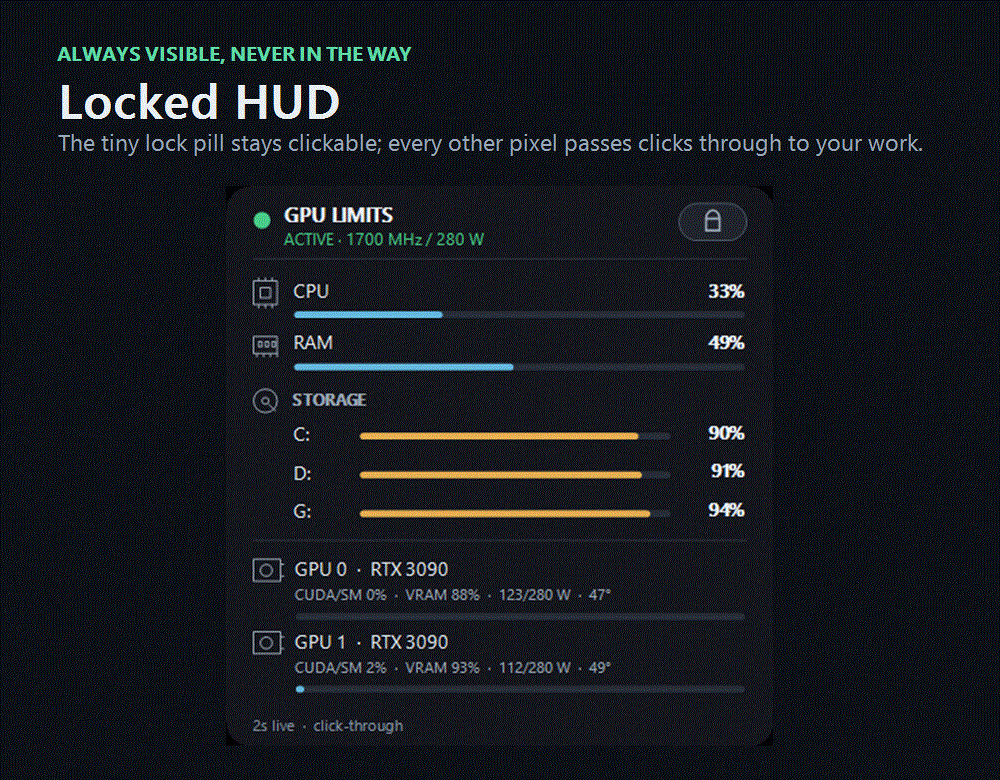

# CA AutoConfig

[](https://github.com/alirezakeshmirisocial-coder/ca-autoconfig/releases/tag/v0.2.3-alpha.1)
[](LICENSE)
[](https://github.com/alirezakeshmirisocial-coder/ca-autoconfig/stargazers)
[](https://github.com/alirezakeshmirisocial-coder/ca-autoconfig/discussions)

CA AutoConfig is a lightweight Windows HUD and conservative GPU power companion for local-AI and multi-GPU workstations. It keeps essential CPU, memory, storage, CUDA/SM, VRAM, temperature, and board-power information visible without stealing focus from the applications underneath it.

[Latest alpha](https://github.com/alirezakeshmirisocial-coder/ca-autoconfig/releases/tag/v0.2.3-alpha.1) · [Desktop preview](docs/DESKTOP_PREVIEW.md) · [Hardware matrix](docs/HARDWARE_MATRIX.md) · [Power-curve lab](benchmark/POWER_CURVE_METHOD.md) · [Architecture](docs/ARCHITECTURE.md) · [Roadmap](ROADMAP.md) · [Contributor issues](https://github.com/alirezakeshmirisocial-coder/ca-autoconfig/milestone/1) · [Discussions](https://github.com/alirezakeshmirisocial-coder/ca-autoconfig/discussions) · [Growth scorecard](docs/launch/GROWTH_SCORECARD.md)



[Static HUD screenshot](docs/assets/hud-alpha.png) · the demo captures only CA AutoConfig windows, never desktop pixels.

> Status: compiled public alpha. Windows and NVIDIA are the first supported platform; the face-presence experiment remains optional and is not a replacement for Windows Hello.

## Current HUD features

- A tiny lock control remains clickable while the rest of the HUD is click-through. Click it or press `Ctrl+Alt+L` to enter edit mode; drag the HUD, then lock it again.
- A visual display map reads the current Windows monitor topology. Double-click the tray icon, right-click the unlocked HUD, or use `HUD settings` in the control panel to choose a display.
- The global lock shortcut, opacity, display, and position are user-configurable and stored locally in `%LOCALAPPDATA%\CAAutoConfig\settings.json`.
- Live NVIDIA telemetry includes GPU identity, CUDA/SM load, VRAM, power draw/cap, temperature, and graphics clock.
- The read-only power advisor proposes a conservative benchmark starting point inside NVIDIA's reported minimum/default range. It never raises an existing lower cap and does not apply changes automatically.
- An isolated adaptive-cooling policy now simulates fan and power advice from ambient temperature, inlet temperature, card heat, neighboring-system heat, fan telemetry, and a matched clean baseline. It is deliberately advice-only until physical tach validation and a crash-safe vendor-auto restore path exist.
- The configured startup profile is pinned to stable NVIDIA GPU UUIDs and verified against current-boot state plus live data. A reordered, missing, replaced, failed, or mismatched target remains clearly red.

The preferred release is a self-contained .NET 8 app: it does not require a separate runtime or PowerShell source compilation. Download and extract the desktop-preview ZIP, verify its checksum, then run:

```powershell
.\Install-DesktopApp.ps1
```

Contributors can build and smoke-test the same app from source:

```powershell
.\Build-DesktopApp.ps1 -SelfContained
.\tests\DesktopApp.Smoke.Tests.ps1 -SelfContained
```

The original `Install-SystemOverlay.ps1` PowerShell-hosted path remains available as a compatibility fallback.

The elevated GPU helper is deliberately separate and opt-in. It requires explicit GPU indices, clock, power, and risk acknowledgement. Indices are used only to select cards during installation; the installed task resolves and pins their stable NVIDIA UUIDs, then preflights every target before changing one. The `280 W / 1700 MHz` values used on the maintainer's workstation are not universal recommendations. Treat advisor values as benchmark candidates for your exact board and workload.

If you run local AI on Windows, the most useful contribution right now is a privacy-safe [hardware or monitor report](https://github.com/alirezakeshmirisocial-coder/ca-autoconfig/issues/new/choose). A star helps discovery, but reproducible results and focused pull requests are more valuable to the project.

## Read-only power-curve lab

The [`benchmark`](benchmark/POWER_CURVE_METHOD.md) lab records steady-window NVIDIA board telemetry beside token or image throughput measured by your workload. It never changes the active power, clock, voltage, or fan profile. Versioned exports omit GPU UUIDs, machine/user names, paths, raw commands, prompts, workflows, and generated content; missing readings remain explicit `null` values.

The local Ollama adapter drives one deterministic `/api/generate` request while sampling GPU telemetry, derives uncached prompt and generation throughput from Ollama's own counters, records failed/too-short runs instead of promoting them, and never pulls a model. Its endpoint is loopback-only unless the user explicitly enables a remote URL.

The llama.cpp adapter launches a user-supplied local `llama-bench` executable and GGUF file, validates its official JSON `pp`/`tg` rows, and samples the selected GPUs during the measured child process. It exports only user-supplied safe model/quantization labels and a build/backend fingerprint—not the GGUF path, raw command, CPU/GPU identity fields, stdout, or stderr. It has no network or download path.

The ComfyUI adapter submits an explicit API-format workflow to an empty local queue, changes only a nominated integer seed between warm-up and measurement, and reports generalized work throughput such as `image/s` through schema-v2. It never downloads generated files or exports the workflow, prompts, output metadata, prompt ID, or endpoint. A remote server requires an explicit override because it receives the complete workflow.

Try the complete calculation and privacy pipeline on synthetic fixtures:

```powershell
.\benchmark\New-PowerCurveReport.ps1 -DryRun -OutputPath .\artifacts\fixture-power-curve.md
.\benchmark\Run-Tests.ps1
```

The generated report compares only matching workload fingerprints and calls its winner the best measured candidate in that dataset—not a universal GPU limit.

## Adaptive cooling lab

The first cooling-system slice is a deterministic, hardware-independent simulation in [`fan-control`](fan-control/ADAPTIVE_FAN_SYSTEM.md). It models the useful quantity as temperature rise above measured room air, rather than chasing one fixed GPU temperature in every environment. A 40°C room therefore reduces the available thermal budget instead of forcing an impossible target or blindly selecting 100% fan.

Its safety order is: protect the card, retain thermal headroom, avoid rapid fan/temperature cycling, then optimize noise and power. The policy includes separate core, hotspot, and VRAM limits; a five-minute basic observation gate; a ten-minute/300-sample predictive-identification gate; chronological held-out validation; hysteresis, dwell, and fan slew limits; multi-GPU heat input; maintenance-baseline comparison; sensor/fan fault latches; and bounded power-reduction advice. Numeric recommendations remain hidden when evidence is incomplete or outside the measured domain.

Nothing in this lab changes GPU settings. `CanApply` is always `false`, vendor automatic fan control remains recommended, and emergencies advise stopping heavy work. Read the [calibration and prediction design](fan-control/CALIBRATION_AND_PREDICTION.md), then run all 52 synthetic safety and predictive scenarios in either supported PowerShell runtime:

```powershell
.\fan-control\Run-Tests.ps1
pwsh -NoProfile -File .\fan-control\Run-Tests.ps1
```

See [ARCHITECTURE.md](docs/ARCHITECTURE.md), [ROADMAP.md](ROADMAP.md), [CONTRIBUTING.md](CONTRIBUTING.md), [PRIVACY.md](PRIVACY.md), [SECURITY.md](SECURITY.md), and [CODE_OF_CONDUCT.md](CODE_OF_CONDUCT.md) for the public-release direction.

---

## راهنمای فارسی پروژه

### CA Unlock Guard

یک محافظ سبک و برگشت‌پذیر برای ویندوز است. با هر ورود یا بازشدن قفلِ Session، پوشهٔ `CA` روی Desktop واقعی کاربر ساخته می‌شود و یک شمارش معکوس آغاز می‌گردد. اگر چالش در زمان تعیین‌شده تأیید نشود، ویندوز دوباره Lock می‌شود و رخداد در لاگ ثبت می‌گردد.

## مدل‌های تأیید

- `CodeAndFace` (پیش‌فرض این دستگاه): ابتدا PIN/کد اختصاصی Guard و سپس چهره با وب‌کم بررسی می‌شود. هر دو باید پیش از پایان زمان موفق شوند.
- `Code`: کاربر فقط کد/عبارت اختصاصی Guard را وارد می‌کند. حذف پوشه به‌تنهایی تأیید محسوب نمی‌شود و به‌عنوان دست‌کاری ثبت خواهد شد.
- `FolderDelete`: حذف پوشهٔ `CA` در مهلت تعیین‌شده تأیید محسوب می‌شود. این حالت ساده‌تر است، اما هر کسی که سازوکار را بداند می‌تواند آن را دور بزند.

این ابزار جایگزین Windows Hello، رمز قوی، BitLocker یا قفل خودکار ویندوز نیست. برنامه‌ای که با همان حساب کاربری اجرا شود می‌تواند پردازش Guard را متوقف کند؛ بنابراین این پروژه یک لایهٔ tripwire و بازقفل‌کردن مجدد است، نه یک مرز امنیتی در سطح سیستم‌عامل.

## فاز اول: Presence Lab بدون Lock

قبل از نصب Scheduled Task، رفتار واقعی دوربین را با نورها و زاویه‌های مختلف تست کنید:

```powershell
.\Start-SFacePresenceTest.ps1
```

نسخهٔ پیشنهادی Lab از `YuNet + SFace` استفاده می‌کند. YuNet صورت و پنج نقطهٔ کلیدی آن را پیدا می‌کند، SFace تصویر هم‌تراز‌شده را به embedding تبدیل می‌کند و Enrollment جداگانه از روبه‌رو، کمی چپ و کمی راست می‌گیرد. این روش نسبت به Haar/LBPH قبلی در زاویهٔ معمول میز پایدارتر است. تصویر یا ویدئوی خام ذخیره نمی‌شود؛ فقط embedding محلی ذخیره می‌گردد.

برای اجرای کنترل‌شدهٔ ۲۴ساعته:

```powershell
.\Start-SFacePresenceTest.ps1 -DurationHours 24 -BaselineSeconds 2
```

اجرای بالا برای تست تعاملی است و ممکن است با بسته‌شدن ترمینال پایان یابد. برای تست پایدار مستقل از Codex/Terminal، پس از Enrollment اجرا کنید:

```powershell
.\Start-DurablePresenceTest.ps1 -Engine SFace -DurationHours 24 -BaselineSeconds 2
```

این دستور فقط Task موقت `CA Presence Lab (NO LOCK)` را می‌سازد. Task هیچ کد یا مسیر Lock ندارد، زمان پایان ثابت را در `durable-run.json` نگه می‌دارد و با triggerهای Logon و SessionUnlock در صورت Logoff/Restart یا توقف پردازش تا پایان همان بازه ادامه می‌دهد. سیاست `IgnoreNew` اجازه نمی‌دهد دو نمونه هم‌زمان اجرا شوند. برای توقف دستی بدون پاک‌کردن گزارش‌ها:

```powershell
.\Stop-DurablePresenceTest.ps1
```

ابتدا مدل‌ها و Enrollment را آماده کنید:

```powershell
.\Start-SFacePresenceTest.ps1 -SetupOnly
```

اجرای اول یک runtime ایزوله می‌سازد و Enrollment روبه‌رو، کمی چپ و کمی راست را انجام می‌دهد. پایش جدید تطبیقی است تا inferenceها یک‌جا روی CPU نریزند:

- در حالت سالم هر ۲ ثانیه فقط یک فریم پردازش می‌شود.
- اگر شباهت مرزی، نبودن صورت یا کیفیت نامناسب دیده شود، موقتاً هر ۱ ثانیه بررسی می‌شود.
- اگر وضعیت ضعیف ۶ ثانیه ادامه یابد، هشدار روی پنجره می‌آید و حداکثر ۱۰ نمونه با فاصلهٔ ۰٫۵ ثانیه گرفته می‌شود.
- سه نتیجهٔ قوی پیاپی مرحلهٔ تأییدی را زودتر تمام می‌کند.
- OpenCV فقط از دو thread استفاده می‌کند تا spike لحظه‌ای CPU محدود بماند.

- سبز (`OWNER VERIFIED`): تعداد و نسبت کافی از فریم‌های باکیفیت با صاحب سیستم تطبیق داشته‌اند.
- قرمز (`NOT OWNER`): یک چهرهٔ واضح در تعداد کافی فریم دیده شده، ولی نتیجه به‌صورت پایدار mismatch بوده است.
- نارنجی (`UNCERTAIN`): چهره وجود نداشته یا نور، blur، زاویه یا رأی‌ها برای تصمیم قطعی مناسب نبوده‌اند.
- خاکستری (`CAMERA ERROR`): دوربین باز نشده یا ارسال فریم متوقف شده است؛ برنامه هر سه ثانیه برای بازیابی دوربین تلاش می‌کند.

اجرای تعاملی Presence Lab هیچ Scheduled Taskی نمی‌سازد؛ اجرای durable فقط Task موقت `NO LOCK` را می‌سازد. در هر دو حالت تحت هیچ شرایطی ویندوز Lock نمی‌شود. کنترل‌های پنجره:

- `Space`: اسکن فوری
- `+` و `-`: تغییر threshold؛ در SFace عدد بالاتر سخت‌گیرانه‌تر است
- `S`: ذخیرهٔ profile آزمایش‌شده
- `Esc`: خروج

نتیجه‌های دوره‌ای و تغییر حالت‌ها شامل status، similarity، رأی‌های مرحلهٔ تأییدی و کیفیت تصویر در `%LOCALAPPDATA%\CAUnlockGuardLab\presence-events-sface-adaptive.jsonl` ثبت می‌شود. برای جلوگیری از I/O اضافی، در حالت سالم فقط از هر ۱۰ نمونه یک مورد نوشته می‌شود. گزارش خلاصه:

```powershell
.\Get-PresenceTestReport.ps1
```

گزارش به‌طور پیش‌فرض فقط اجرای پایدار فعلی را نشان می‌دهد؛ برای دیدن همهٔ اجراهای قبلی از `-IncludeHistory` استفاده کنید.

برای Enrollment مجدد:

```powershell
.\Start-SFacePresenceTest.ps1 -ReEnroll -SetupOnly
```

برای دوربین دوم یا فاصلهٔ زمانی متفاوت:

```powershell
.\Start-SFacePresenceTest.ps1 -CameraIndex 1 -BaselineSeconds 2
```

موتور قدیمی LBPH برای مقایسه و fallback همچنان با `Start-PresenceTest.ps1` و گزینهٔ `-Engine LBPH` در اجرای پایدار در دسترس است.

### اجرای دائمی بعد از Logon و Unlock

نصب پیشنهادی و یکپارچه:

```powershell
.\Install-CombinedAutoconfig.ps1
```

این دستور در حالت پیش‌فرض فقط HUD کم‌خطر و میانبر `CA AutoConfig` را نصب می‌کند. دوربین و تغییر تنظیمات GPU عمداً opt-in هستند. برای نصب هر سه بخش روی همین دستگاه، باید شاخص کارت‌ها و مقادیر مخصوص همان برد را صریح وارد و ریسک سخت‌افزار را تأیید کنید:

```powershell
.\Install-CombinedAutoconfig.ps1 -InstallPresenceMonitor -InstallGpuLimits -GpuIndexList '0,1' -MaxGraphicsClockMHz 1700 -PowerLimitWatts 280 -AcceptHardwareRisk
```

کنترل‌پنل دکمه‌های Start/Stop برای کل سیستم و هر بخش جدا، فعال/غیرفعال‌کردن Auto-start و نمایش وضعیت زندهٔ GPU را دارد. عملیات GPU یک UAC نشان می‌دهد، چون تغییر کلاک و توان بدون Administrator ممکن نیست.

پنجرهٔ دوربین با هر اجرا Minimized می‌شود و در هشدارها نیز Minimized باقی می‌ماند؛ برای دیدنش باید آن را از Taskbar باز کنید.

### HUD سخت‌افزار روی مانیتورها

Task با نام `CA System Overlay` بعد از Logon و SessionUnlock اجرا می‌شود. در نصب اول، مانیتور سوم انتخاب می‌شود؛ بعد از آن کاربر می‌تواند از پنجرهٔ تنظیمات، چیدمان واقعی مانیتورها را ببیند و نمایشگر دلخواه را انتخاب کند. اگر نمایشگر انتخاب‌شده قطع شود، HUD خودسرانه به مانیتور دیگری منتقل نمی‌شود.

HUD در حالت عادی نیمه‌شفاف، بدون Focus و click-through است. فقط دکمهٔ بسیار کوچک قفل در گوشهٔ آن کلیک‌پذیر باقی می‌ماند. با کلیک روی قفل یا میانبر پیش‌فرض `Ctrl+Alt+L`، حالت ویرایش فعال می‌شود؛ در این حالت HUD را می‌توان Drag کرد و با Right-click تنظیمات را باز کرد. میانبر، opacity، مانیتور و موقعیت در `%LOCALAPPDATA%\CAAutoConfig\settings.json` ذخیره می‌شوند. پنجرهٔ تنظیمات از Tray icon یا دکمهٔ `HUD settings` در کنترل‌پنل نیز باز می‌شود.

اطلاعات هر دو ثانیه در thread پس‌زمینه به‌روز می‌شود و شامل موارد زیر است:

- چراغ سبز/قرمز محدودیت GPU؛ سبز فقط وقتی نمایش داده می‌شود که state موفق مربوط به همین Boot برای تمام کارت‌های پیکربندی‌شده باشد، Power Limit زنده با پروفایل یکسان بماند و کلاک زنده از سقف عبور نکرده باشد.
- درصد CPU و RAM.
- درصد فضای مصرف‌شدهٔ درایوهای اصلی؛ پارتیشن‌های کوچک Boot/Recovery برای جلوگیری از شلوغی نمایش داده نمی‌شوند.
- برای هر GPU درصد `CUDA/SM`، مصرف VRAM، توان لحظه‌ای/سقف توان، دما و کلاک گرافیکی.
- Power Advisor فقط یک نقطهٔ شروع محافظه‌کارانه را در بازهٔ مجاز کارت نشان می‌دهد. مقدار پیشنهادی به‌صورت خودکار اعمال نمی‌شود، از سقف پیش‌فرض کارت بالاتر نمی‌رود و cap پایین‌تر موجود را افزایش نمی‌دهد.

### آزمایشگاه خنک‌سازی تطبیقی

منطق اولیه در پوشهٔ `fan-control` به‌صورت کاملاً شبیه‌سازی‌شده پیاده‌سازی شده است. دمای اتاق و هوای ورودی، توان خود کارت، گرمای GPUهای دیگر، دور فن، محدودیت‌های همان مدل کارت و baseline تمیز را کنار هم می‌گذارد. در اتاق ۴۰ درجه هدف غیرممکن تعریف نمی‌کند؛ بودجهٔ حرارتی کمتر را نشان می‌دهد و در صورت نیاز کاهش توان یا workload را به‌جای فشار بی‌نتیجه به فن پیشنهاد می‌کند.

برای کاهش thermal stress، تغییرات پیشنهادی فن دارای hysteresis، حد سرعت تغییر و زمان مکث است تا فن و دما مدام بالا و پایین نپرند. Core، hotspot و VRAM جداگانه کنترل می‌شوند و خطای سنسور، توقف فیزیکی فن یا نزدیک‌شدن سریع به حد حرارتی اولویت مطلق دارد. فعلاً این بخش فقط **Simulation / Advice** است: هیچ فرمان فن یا توان اجرا نمی‌کند و `CanApply` همیشه false می‌ماند تا tach واقعی، سازگاری هر مدل کارت، watchdog مستقل و بازگردانی تأییدشدهٔ vendor-auto روی سخت‌افزار واقعی آزمایش شوند.

کنترل HUD از میانبر `CA AutoConfig` و دکمه‌های `Start HUD` و `Stop HUD` انجام می‌شود. نصب یا بازسازی جداگانه:

```powershell
.\Install-SystemOverlay.ps1
```

حذف Task بدون دست‌زدن به بقیهٔ اجزا:

```powershell
.\Uninstall-SystemOverlay.ps1
```

بعد از پایان تست، مانیتور تطبیقی را می‌توان به‌صورت دائمی نصب کرد:

```powershell
.\Install-PresenceMonitor.ps1
```

این فرمان Task با نام `CA Presence Monitor (NO LOCK)` را با triggerهای `Logon` و `SessionUnlock` می‌سازد. مانیتور مدت پایان ندارد، با حساب عادی کاربر اجرا می‌شود، پنجرهٔ دوربین را Minimized نگه می‌دارد و هیچ API یا مسیر Lock در آن وجود ندارد. برای حذف Task بدون پاک‌شدن مدل و لاگ‌ها:

لاگ مانیتور در فایل‌های ۲۵MB می‌چرخد و حداکثر سه نسخهٔ قبلی نگه داشته می‌شود تا اجرای دائمی باعث رشد نامحدود فایل نشود.

```powershell
.\Uninstall-PresenceMonitor.ps1
```

### محدودیت اختیاری GPU انویدیا

نمونهٔ زیر دقیقاً پروفایل مخصوص سیستم فعلی را روی GPUهای 0 و 1 بعد از هر Logon نصب می‌کند. این اعداد توصیهٔ عمومی نیستند؛ ابتدا بازهٔ توان برد خودتان را با `nvidia-smi` و مستندات سازنده بررسی کنید:

```powershell
.\Install-GpuLimits.ps1 -GpuIndexList '0,1' -MaxGraphicsClockMHz 1700 -PowerLimitWatts 280 -AcceptHardwareRisk
```

نصاب indexهای انتخاب‌شده را یک‌بار به UUID پایدار NVIDIA تبدیل می‌کند، سپس UAC درخواست می‌کند و Task با نام `CA GPU Limits` را تحت حساب `SYSTEM` ثبت می‌کند. Task بعد از نصب دیگر به ترتیب متغیر indexها وابسته نیست. قبل از هر تغییر، هویت تمام GPUها و بازهٔ توان آن‌ها بررسی می‌شود. اگر مرحلهٔ اعمال شکست بخورد، اسکریپت به‌صورت best-effort قفل کلاک خودش را reset و Power Limit قبلی را restore می‌کند و نتیجهٔ rollback را در state ثبت می‌کند. Task پانزده ثانیه بعد از Logon اجرا می‌شود و از نظر عملکرد معادل چهار فرمان زیر با UUID واقعی کارت‌ها است:

```powershell
nvidia-smi -i GPU-<uuid-of-selected-card-0> -pl 280
nvidia-smi -i GPU-<uuid-of-selected-card-0> -lgc 0,1700
nvidia-smi -i GPU-<uuid-of-selected-card-1> -pl 280
nvidia-smi -i GPU-<uuid-of-selected-card-1> -lgc 0,1700
```

وضعیت آخر در `C:\ProgramData\CAGpuLimits\gpu-limits-state.json` و خروجی جزئی در `C:\ProgramData\CAGpuLimits\gpu-limits.log` ذخیره می‌شود. حذف Task:

```powershell
.\Uninstall-GpuLimits.ps1
```

حذف Task تنظیم فعلی درایور را فوراً reset نمی‌کند؛ تنظیمات موجود تا reboot یا reset درایور باقی می‌ماند.

دادهٔ آزمایش در `%LOCALAPPDATA%\CAUnlockGuardLab` است و با دستور زیر کاملاً حذف می‌شود:

```powershell
.\Remove-PresenceTest.ps1
```

تا زمانی که سبز/قرمز در شرایط واقعی قابل‌اعتماد نشده، `Install-Guard.ps1` را اجرا نکنید. اتصال monitor دائمی به Lock مرحلهٔ بعد از تأیید نتایج Presence Lab است. در نسخهٔ نهایی خطای دوربین هرگز failure هویتی محسوب نخواهد شد و Lock فقط پس از چند نتیجهٔ قطعی و متوالی فعال می‌شود.

## نصب

PowerShell را با همان حسابی که قرار است محافظت شود باز کنید. اجرای پیش‌فرض حالت `CodeAndFace` را نصب می‌کند:

```powershell
.\Install-Guard.ps1
```

نصاب یک PIN/Guard code می‌گیرد، یک Python venv ایزوله در `%LOCALAPPDATA%` می‌سازد، نسخهٔ pinned از OpenCV را نصب می‌کند و سپس پنجرهٔ دوربین را برای Enrollment باز می‌کند. مقدار خام PIN ذخیره نمی‌شود؛ فقط مشتق PBKDF2 به‌همراه salt ذخیره می‌شود. مدل LBPH چهره روی همان سیستم ذخیره می‌شود و فریم‌ها یا ویدئوی خام روی دیسک نوشته نمی‌شوند.

برای انتخاب دوربین دوم یا تغییر حساسیت:

```powershell
.\Install-Guard.ps1 -CameraIndex 1 -FaceThreshold 70 -TimeoutSeconds 30
```

در LBPH مقدار threshold کمتر سخت‌گیرانه‌تر نیست؛ برعکس، **عدد پایین‌تر سخت‌گیرانه‌تر** و عدد بالاتر پذیراتر است. مقدار `70` نقطهٔ شروع است و باید با نور واقعی اتاق تست شود.

برای حالت فقط کد:

```powershell
.\Install-Guard.ps1 -Mode Code
```

برای حالت سادهٔ حذف پوشه:

```powershell
.\Install-Guard.ps1 -Mode FolderDelete
```

برای تعیین مهلت و webhook اختیاری:

```powershell
.\Install-Guard.ps1 -TimeoutSeconds 30 -WebhookUrl 'https://example.invalid/private-hook'
```

Webhook یک درخواست JSON شامل نام ماشین، نام کاربر، زمان UTC و دلیل شکست دریافت می‌کند. آدرس webhook در فایل تنظیمات محلی کاربر ذخیره می‌شود.

نصاب فایل اجرایی را در `%LOCALAPPDATA%\CAUnlockGuard` کپی می‌کند و یک Scheduled Task با دو trigger می‌سازد: `Logon` و `SessionUnlock`. سطح اجرای Task برابر حساب عادی کاربر است و دسترسی Administrator نمی‌خواهد، مگر سیاست‌های محلی ویندوز آن را محدود کرده باشند.

## تست امن

تست دودزا هیچ Taskی نصب نمی‌کند و هرگز سیستم را Lock نمی‌کند:

```powershell
.\tests\Guard.Smoke.Tests.ps1
```

برای اجرای دستی Guard بدون Lock واقعی:

```powershell
.\Guard.ps1 -NoLock -TimeoutSecondsOverride 10
```

پس از نصب، تشخیص چهره را مستقل و بدون Lock تست کنید:

```powershell
.\Test-Face.ps1
```

برای Enrollment مجدد یا تنظیم threshold:

```powershell
.\Enroll-Face.ps1 -Threshold 65
```

## وضعیت و حذف

```powershell
.\Get-GuardStatus.ps1
.\Uninstall-Guard.ps1
```

حذف عادی Task، فایل اجرایی و تنظیمات را پاک می‌کند، اما لاگ و هشدارها را نگه می‌دارد. برای حذف کامل داده‌های محلی:

```powershell
.\Uninstall-Guard.ps1 -PurgeData
```

## محل داده‌ها و رفتار ایمن

- لاگ: `%LOCALAPPDATA%\CAUnlockGuard\events.jsonl`
- آخرین هشدار پاسخ‌داده‌نشده: `%LOCALAPPDATA%\CAUnlockGuard\pending-alert.json`
- مدل چهره: `%LOCALAPPDATA%\CAUnlockGuard\face-model.yml`
- اگر از قبل پوشه‌ای به نام `CA` روی Desktop وجود داشته باشد و متعلق به Guard نباشد، Guard برای جلوگیری از آسیب به داده‌های کاربر **Fail-open** می‌کند و سیستم را Lock نمی‌کند.
- Guard هیچ فایل شخصی را به‌صورت recursive حذف نمی‌کند. فقط marker خودش را پاک می‌کند و پوشه را تنها وقتی حذف می‌کند که خالی باشد.
- شکست webhook مانع Lock یا ثبت لاگ محلی نمی‌شود.

## محدودیت مهم

اگر شخص دیگری PIN/Password ویندوز شما را می‌داند، قفل‌کردن دوباره به‌تنهایی جلوی او را نمی‌گیرد. حالت `CodeAndFace` یک مانع اضافی متناسب با محیط خانگی ایجاد می‌کند، اما وب‌کم RGB و LBPH تشخیص زنده‌بودن مطمئن ندارند و ممکن است با عکس یا ویدئو فریب بخورند. برای امنیت جدی‌تر مرحلهٔ بعدی بهتر است Windows Hello با دوربین IR، TOTP روی تلفن، کلید FIDO2 یا تأیید push باشد.

### دربارهٔ تشخیص چهره

مسیر امن برای چهره، استفاده از Windows Hello است؛ در این حالت خود ویندوز تطبیق بیومتریک را انجام می‌دهد و برنامه به تصویر یا template چهره دسترسی پیدا نمی‌کند. وب‌کم RGB معمولی الزاماً برای Hello Face کافی نیست و معمولاً دوربین IR سازگار لازم است. روی دستگاه فعلی، `Microsoft LifeCam Studio` به‌عنوان دستگاه `Image` شناخته شد و تست رسمی `UserConsentVerifier.CheckAvailabilityAsync()` نتیجهٔ `DeviceNotPresent` داد؛ بنابراین فعلاً نمی‌توان از آن به‌عنوان Windows Hello Face استفاده کرد.

به درخواست صاحب سیستم، این نسخه برای سناریوی خانگی از LifeCam و تطبیق محلی LBPH به‌عنوان عامل دوم در کنار PIN استفاده می‌کند. موفقیت چهره به‌تنهایی کافی نیست. اگر بعداً دوربین سازگار با Windows Hello اضافه شود، بهتر است حالت سفارشی با `WindowsHello` جایگزین شود تا تشخیص بیومتریک و نگه‌داری template کاملاً در اختیار ویندوز باشد.
