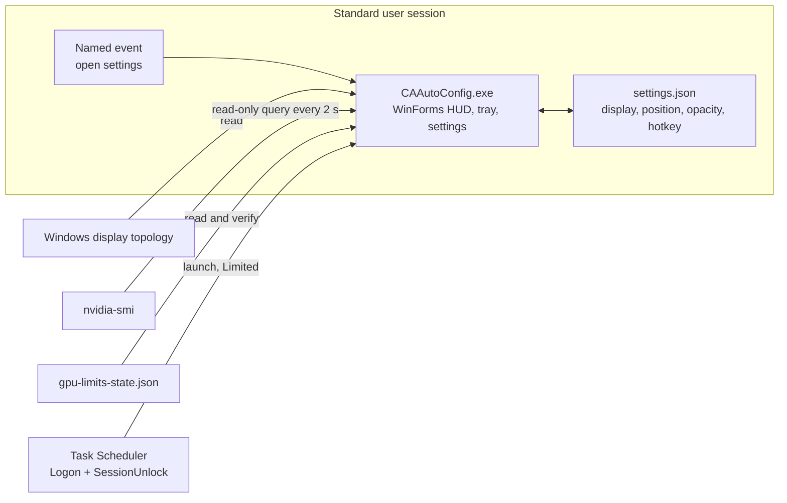
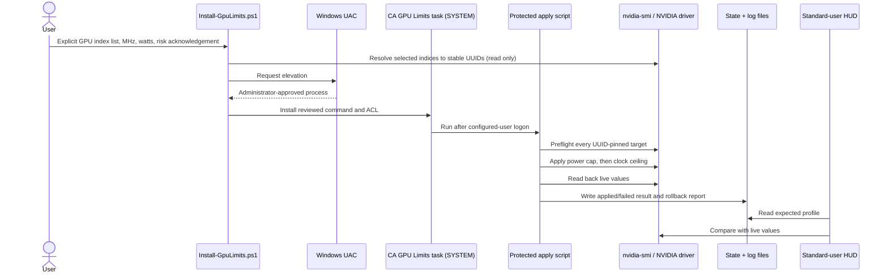
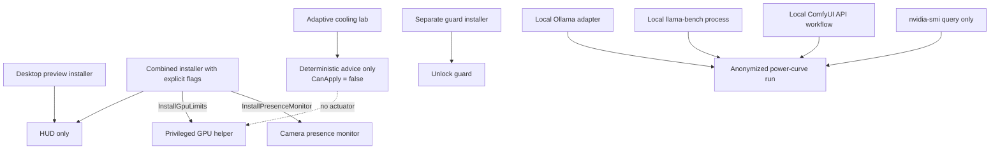

# CA AutoConfig architecture

CA AutoConfig separates an always-on, standard-user HUD from the one optional operation that needs administrator rights: applying explicit NVIDIA limits. Camera experiments and the unlock guard are separate opt-in tools; neither is installed by the desktop-preview installer.

This document describes the current `v0.2` architecture and the safety boundaries contributors must preserve.

## Runtime map



The desktop process is single-instance per user session through the `Local\CA-SystemOverlay` mutex. A second invocation with `--open-settings` signals `Local\CA-SystemOverlay-OpenSettings` and exits instead of creating another HUD.

The metrics collector runs off the UI thread and suppresses overlapping collections. Its normal interval is two seconds. NVIDIA access is behind an internal telemetry-source boundary: production uses a process-backed `nvidia-smi` source, while tests inject a deterministic recorded source with no process or hardware access. Missing, timed-out, failed, empty, partial, malformed, and explicit-`N/A` responses have separate fail-closed outcomes. The app reads Windows CPU, memory, disk, and monitor data plus NVIDIA telemetry; it contains no network client and does not write GPU settings. An explicit **Copy diagnostics** click assembles a sanitized report and writes it only to the local clipboard.

## HUD interaction model

The overlay starts locked. In that state only the small lock rectangle accepts pointer input; the rest of the window returns click-through hit-test results. Unlocking enables drag and right-click settings. The configured global shortcut performs the same state change.

Monitor selection stores the Windows display device name and a per-display position. If that display disappears, the HUD does not silently jump to another monitor. Per-monitor-v2 DPI awareness is enabled before WinForms creates a window, so the same logical layout is scaled by the target display rather than by the primary monitor.

Settings live at:

```text
%LOCALAPPDATA%\CAAutoConfig\settings.json
```

The file has a schema version. Older unversioned settings migrate forward; if the app finds a newer schema, it uses safe defaults for the session and refuses to overwrite the file.

## Read-only power advisor

The HUD asks `nvidia-smi` for each card's current draw, active cap, default cap, supported minimum/maximum, temperature, graphics clock, CUDA/SM load, and VRAM use. The advisor may display a conservative benchmark starting point, but it cannot apply it.

Current invariants:

- A suggested power cap stays inside the range reported by the driver.
- It never raises an already lower active cap.
- It is labeled as a starting point, not a board-independent recommendation.
- Applying a cap remains a separate, explicit, elevated workflow.

Workload-aware recommendations require measured throughput and stability evidence and remain roadmap work.

## Optional privileged GPU path



Installation requires all of these inputs: GPU indices, maximum graphics clock, power limit, and `-AcceptHardwareRisk`. Numeric indices select the cards once; before UAC the installer resolves them through a read-only NVIDIA query and carries their validated UUIDs into the protected task. Every UUID-pinned target is preflighted before any card is changed. If a later operation fails, the helper makes a best-effort reverse-order rollback against the same UUID: reset the graphics-clock lock and restore the original power cap for each changed card.

The installed source and state are under:

```text
%ProgramData%\CAGpuLimits\
```

That directory is administrator-owned and rejects reparse-point installation. SYSTEM and Administrators receive full control; standard Users receive read and execute access. The scheduled task runs as SYSTEM, but its task descriptor grants only the configured user read/run access, not permission to rewrite the action. The control panel's Apply action starts that exact reviewed task and waits for a fresh state result; it never reconstructs the helper command. Reset requires elevation, reads and preflights the applied UUID-pinned profile, and refuses to guess targets when state is missing or invalid. This lets the configured user inspect, stop, and start the approved profile without turning the UI into a general elevation path.

The HUD's green GPU indicator is not based on the state file alone. It requires a successful state from the current boot, the same configured profile across the expected UUIDs, matching live power caps, and graphics clocks that do not exceed the ceiling beyond a small telemetry tolerance. A driver/reboot index reorder is accepted only when UUID identity still matches; a different card at an old index stays red. Missing, stale, failed, or mismatched evidence also stays red. Index-only state from older releases remains readable so upgrades fail safely without an unnecessary outage.

## Optional experiments stay outside the default install



- The presence lab performs local enrollment and inference. Its SFace path stores embeddings, not raw camera frames, and its test mode never locks Windows.
- The unlock guard can relock Windows after a failed challenge, but it is a separate installation and is not a replacement for Windows Hello, BitLocker, or operating-system access control.
- The Ollama adapter sends a user-supplied prompt to loopback by default, samples NVIDIA telemetry during that request, and exports neither prompt nor generated text. Remote endpoints require an explicit flag. It cannot pull models, elevate, or change a GPU profile.
- The llama.cpp adapter launches only explicit local inputs, validates the exact official JSON `pp`/`tg` result shape, and samples telemetry during the measured process. It has no network/download/elevation path and exports neither local paths, raw commands, child streams, nor llama-bench machine fields.
- The ComfyUI adapter sends an explicit API-format workflow to loopback by default, requires an empty queue, changes only the nominated seed between warm-up and measurement, and reports schema-v2 work units. It never fetches outputs or exports workflow/history content; a remote endpoint requires explicit opt-in.
- The adaptive cooling assembly is deterministic and hardware-independent. It has no hardware adapter, process launch, persistence, network access, or write path; `CanApply` is always `false`.

See [PRIVACY.md](../PRIVACY.md), [SECURITY.md](../SECURITY.md), and the [adaptive cooling design](../fan-control/ADAPTIVE_FAN_SYSTEM.md) for the detailed policies.

## Trust boundaries

| Boundary | Allowed today | Deliberately excluded |
| --- | --- | --- |
| HUD process | Read telemetry; draw UI; save user settings; register a hotkey; copy an explicitly requested sanitized diagnostic to the local clipboard | Administrator elevation; GPU writes; camera access; network telemetry; automatic report upload |
| Settings event | Ask the existing user-session process to open its settings window | Arbitrary commands or payloads |
| GPU installer | Validate explicit values; request UAC; install one fixed task action | Silent elevation; inferred GPU targets; universal power presets |
| GPU task | Run the protected apply script as SYSTEM; write result/log files | User-controlled command lines; hidden profile changes |
| Ollama benchmark | Call a local model; read official timing counters; query NVIDIA telemetry; write an anonymized run | Model pulls; implicit remote prompts; GPU writes; prompt/response export |
| llama.cpp benchmark | Launch explicit local `llama-bench`/GGUF inputs; validate official JSON; query NVIDIA telemetry; write an anonymized run | Downloads; network clients; elevation; GPU writes; path/command/console export |
| ComfyUI benchmark | Submit an explicit workflow to an empty opted-in endpoint; query completion and NVIDIA telemetry; write generalized anonymized throughput | Implicit remote workflows; output downloads; global interrupt/free/history mutation; GPU writes; workflow/history export |
| Presence experiment | Local camera inference after opt-in | Default installation; cloud face processing; raw-frame retention in SFace mode |
| Cooling simulation | Return bounded advice and emergency status | Device writes or authorization to apply advice |

## Failure behavior

- No selected monitor: keep the tray process alive and do not move the HUD elsewhere.
- Shortcut collision: keep the previous setting and show a recoverable conflict message.
- Missing or malformed NVIDIA telemetry: render unknown/red rather than claim success.
- Newer settings schema: fall back in memory and block writes.
- GPU preflight failure: change no card.
- Partial GPU apply failure: attempt rollback, record every result, and leave the HUD red.
- Missing camera or uncertain face evidence: report uncertainty/error; do not treat it as owner verification.
- Missing cooling evidence or out-of-domain conditions: suppress numeric advice; emergencies still surface immediately.

## Build and verification map

| Surface | Verification |
| --- | --- |
| Unlock guard | `tests/Guard.Smoke.Tests.ps1` exercises success, timeout-with-lock-suppressed, and fail-open collision behavior. |
| HUD core | `tests/SystemOverlay.Smoke.Tests.ps1` compiles the shared source, round-trips settings, verifies diagnostic UUID/path redaction, validates live multi-GPU telemetry, and exercises 13 deterministic NVIDIA identity/state/success/failure cases. |
| Compiled app | `tests/DesktopApp.Smoke.Tests.ps1` builds and launches the .NET entry point in a no-hardware-write smoke mode. |
| Privileged helper | `tests/GpuLimits.Safety.Tests.ps1` checks explicit targets, preflight-before-write, rollback, ACL intent, and safe combined-installer defaults without changing hardware. |
| Power-curve lab | `benchmark/Run-Tests.ps1` runs 25 schema/report/card tests, nine Ollama tests, nine llama-bench tests, and eight ComfyUI tests in both PowerShell runtimes, including unit-aware efficiency, workload isolation, evidence-gated SVG output, failure retention, cache rejection, remote-endpoint rejection, concurrent fixture telemetry, and privacy omission. |
| Cooling model | `fan-control/Run-Tests.ps1` runs the isolated safety, calibration, prediction, drift, and emergency scenarios. |
| Demo | `tools/Capture-HudDemo.ps1` uses `PrintWindow` on CA AutoConfig windows only, verifies state transitions, and restores the HUD to locked mode. |

The prepared Windows workflow is in [`docs/ci.yml.example`](ci.yml.example). It cannot become an active `.github/workflows` file until the maintainer's GitHub token is authorized for workflow changes.

## Near-term hardening

The current public preview intentionally exposes the remaining work:

1. Replace the script-based privileged action with a minimal authenticated helper and explicit reset operation.
2. Add a WDDM provider/fallback with the same capability and failure contract as the simulated NVIDIA source.
3. Sign binaries and exercise install, upgrade, uninstall, sleep, driver-reset, and clean-machine recovery in CI.
4. Keep measured workload benchmarks separate from generic or vendor-independent claims.

Changes that weaken the privilege split, make GPU writes implicit, convert unknown evidence into success, or connect cooling advice directly to an actuator are architecture changes and require a security-focused review.
