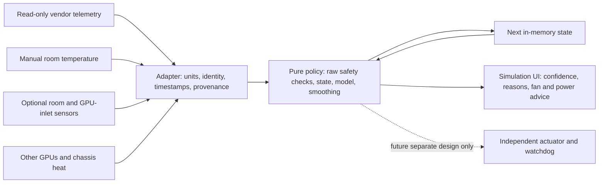

# Adaptive GPU cooling: observation and simulation prototype

Research checked: **10 October 2026**. Scope: CA AutoConfig on Windows; isolated C# 5 policy and PowerShell tests. Nothing here is connected to the overlay, installer, startup tasks, GPU driver, or existing power-limit scripts.

**Every result is advice. `CanApply` is always `false`.** The prototype has no hardware adapter, GPU write operation, process launch, external dependency, clock access, persistence, or network access. `VendorAutoRecommended` means “retain or request the vendor controller”; it does not report that a restoration command succeeded. Numeric advice is withheld until observation and calibration succeed. Emergency alerts are immediate even before calibration.

## Deliverables and use

- `AdaptiveFanPolicy.cs`: deterministic policy, telemetry/profile DTOs, explicit state, and bounded recommendations.
- `AdaptiveFanPolicy.Tests.cs`: synthetic scenarios and invariants; its GPU profile is fictional and must never be used for hardware.
- `Run-Tests.ps1`: compiles both files in memory and runs the suite. No GPU is required.

From the repository directory, run either command in a fresh process:

```powershell
powershell.exe -NoProfile -ExecutionPolicy Bypass -File .\fan-control\Run-Tests.ps1
pwsh.exe -NoProfile -File .\fan-control\Run-Tests.ps1
```

The runtime uses the same C#/`Add-Type` approach as the Windows project. Run a fresh process after edits because loaded .NET types persist for that process. Existing project files were not edited.

## Evidence and design decisions

**Official NVIDIA interface facts.** Fan speed queries describe intended operating speed; the percent query explicitly cannot establish whether a blocked fan spins. The RPM query is also documented as intended speed. Therefore an adapter must independently establish physical tachometer provenance. Query vendor fan bounds, power constraints, device identity, and supported temperature readings; unsupported responses stay unknown. Board-power queries use milliwatts, with architecture-dependent averaging. See [NVML device queries](https://docs.nvidia.com/deploy/nvml-api/latest/api/group__nvmlDeviceQueries.html).

Setting a manual fan speed transfers temperature-management responsibility to the caller. NVIDIA documents the default-fan call for restoring the default policy. This prototype deliberately has no such calls. Any future actuator would require verified restoration on each supported board/driver combination, including crash recovery. See [NVML device commands](https://docs.nvidia.com/deploy/nvml-api/latest/api/group__nvmlDeviceCommands.html).

The current enum reference includes a hottest-die sensor, `NVML_TEMPERATURE_GPU_MAX`; availability on a particular installed driver/card must still be detected. GPU and memory thresholds have separate meanings. See [NVML sensor and threshold enums](https://docs.nvidia.com/deploy/nvml-api/latest/api/group__nvmlDeviceEnums.html). NVIDIA also documents relative **T.Limit** margins: do not parse a margin as an absolute Celsius temperature. Memory readings are supported only on some devices. See [NVIDIA-SMI temperature documentation](https://docs.nvidia.com/deploy/nvidia-smi/index.html#temperature).

**Thermal-control foundations.** TI explains why thermal resistance depends on test conditions and why package data cannot simply be transplanted to a different system. The estimates below are local empirical chassis/cooler coefficients, not package specifications: [TI, Semiconductor and IC Package Thermal Metrics, revision D](https://www.ti.com/lit/an/spra953d/spra953d.pdf). Analog Devices describes fan hysteresis, minimum speed, startup, and temperature-controlled fan operation: [Fan Speed Control Techniques in PCs](https://www.analog.com/en/resources/analog-dialogue/articles/fan-speed-control-techniques-in-pcs.html). Those principles motivate this design's dead band, dwell, and independent fault checks; the numeric defaults below are project choices.

**Community evidence is qualitative, not a source of limits.** A [LocalLLaMA discussion of hidden junction/VRAM heat](https://www.reddit.com/r/LocalLLaMA/comments/1h56yko/ai_linux_entousiasts_running_rtx_gpus_your_cards/) highlights the weakness of core-only monitoring; its old sensor-availability claims are not assumed current. A [dual-3090 power discussion](https://www.reddit.com/r/LocalLLaMA/comments/1t4b203/for_those_wondering_about_the_power_consumption/) reports workload-dependent efficiency benefits from reduced power. A [multi-3090 cooling discussion](https://www.reddit.com/r/LocalLLaMA/comments/1vr5r5u/multi3090_users_how_are_you_cooling_your_gpus_in/) describes heat buildup with closely spaced cards. A [PC cooling hysteresis discussion](https://www.reddit.com/r/buildapc/comments/jp64ei/what_is_hysteresis/) illustrates fan hunting. These reports motivate test cases; their wattages, temperatures, performance claims, undervolting instructions, and register-access techniques are not adopted as policy.

Dust accumulation can warrant maintenance, but temperature alone cannot identify its cause. Follow the component manufacturer's cleaning directions; Noctua discusses dust and safe fan cleaning in its [maintenance FAQ](https://www.noctua.at/en/support/faqs/how-should-i-clean-my-noctua-product). The product should suggest inspection, not automatically prescribe repasting, repadding, or disassembly.

## Architecture and boundaries



The delivered module implements `P` and `N`; the remaining components are integration contracts. Use one `Memory` per physical GPU and a chassis coordinator to supply contemporaneous shared heat. The coordinator must keep passive cards, laptops with shared CPU/GPU cooling, external GPUs, MIG instances, and unsupported fan controllers in vendor auto until a suitable verified profile exists. This prototype assumes all fans on one board can use the same conservative percent envelope; heterogeneous fan zones require a future per-fan policy and are unsupported here.

The product should rank objectives lexicographically: (1) fault/thermal safety, (2) sufficient cooling headroom, (3) stable temperature and fan behavior, (4) noise and energy, (5) performance. A soft acoustic preference never overrides an emergency. No voltage, clocks, overclock, undervolt, temperature-limit modification, firmware modification, or undocumented register access belongs in this subsystem.

## Measurements and confidence

Every `Reading` carries a value, acquisition time in monotonic seconds, and an adapter-assigned confidence from 0 to 1. Missing means `null`, never zero. The adapter must preserve the original acquisition timestamp; polling a cache cannot refresh its age. Normalize NVML milliwatts to watts exactly once. Reject relative T.Limit values until converted using documented semantics and matching threshold provenance; never infer an absolute temperature from the field name alone.

Required observations are core temperature, board power, current enforced power limit, explicit other-chassis heat, room ambient, intended percent for **every** fan, and physical tach evidence for numeric advice. Optional hotspot, memory junction, and GPU-inlet sensors become required once declared supported or successfully observed. Their loss then causes fallback, rather than silently becoming “unsupported.” Unsupported junction sensors remain visibly unknown and reduce confidence. A core-only result cannot establish VRAM safety.

`ManualAmbientC` supports an explicit room thermometer reading, including 40°C. It expires after one hour. `AmbientSensorC` is an optional fresh room-air sensor. Use the room sensor when valid; otherwise use a still-valid manual reading. If both differ by more than 3°C, use the warmer value for diagnostics, cap confidence, and restart observation. If neither is valid, withhold numeric advice. Never substitute weather data, an assumed 25°C, GPU temperature, or a motherboard temperature for measured ambient. Place a separate inlet sensor in air entering the GPU cooler, away from direct heatsink contact; room and inlet readings serve different purposes.

The recommendation score starts with the lowest input confidence, caps manual ambient at 0.90, subtracts 0.05 per unsupported junction sensor and 0.05 for no inlet sensor. Unverified tachometry, conflicting ambient inputs, unknown power-limit readback, or lack of proven fan rotation under load caps it below the 0.75 gate. Any such loss revokes calibration. The score is a reproducible **evidence score, not a probability of hardware safety**. `ModelConfidence` is separately capped at 0.55 for fewer than three accepted plateaus and 0.80 thereafter; repeated plateaus improve steady-state evidence but do not identify a full cooling curve.

Input plausibility ranges are defensive parsing limits, not permissible operating ranges: ambient −10…60°C, core/junction −20…150°C, inlet −20…80°C, board power 0…3000 W, other heat 0…20000 W, physical tach 0…20000 RPM. NaN, infinities, future times, stale samples, backward time, repeated core acquisition times, an inlet implausibly colder than the room, or a hotspot below core beyond 2°C tolerance cause fallback. Plausible high temperatures still trigger emergency even if another sensor is invalid.

## Thermal model and operating-point search

Let `Ta` be room temperature, `Ti` GPU inlet temperature, `P` this GPU's board power, `Po` other chassis heat, and `u` fan percent. Celsius differences equal kelvin differences. Local empirical estimates at a settled point are:

```text
Rcase ≈ (Ti − Ta) / (P + Po)                    [°C/W]
Rgpu,j ≈ (Tj − Ti) / P                          [°C/W]
Tj ≈ Ta + Rcase(P + Po) + Rgpu,j(u) P
Reffective ≈ (Tcore − Ta) / P
```

Here `j` independently denotes core, hotspot, or memory. Board watts are a proxy for heating, not a measurement of each junction's dissipation. These coefficients include recirculation, conduction, placement and operating-point effects. Without inlet telemetry, only `Reffective` is available: the prototype returns `CaseResistanceCPerW = null`, uses a same-operating-point temperature/power ratio for advice, and cannot separate the case from the cooler. Missing CPU/other heat biases a case estimate, so zero other heat must be an explicit, justified input. A model fitted during idle is rejected.

The current implementation uses local ratios. A subsequent validated estimator should regress settled `Ti−Ta` against total chassis power, retain an intercept for unmeasured heat, constrain the slope nonnegative, and report residuals and parameter uncertainty. Vary each GPU's load separately to fit `Ti = Ta + sum(k_ij Pj) + offset`; loading every card together makes individual coupling coefficients unidentifiable. The prototype aggregates `Po` and does **not** claim to fit this coupling matrix.

Thermal inertia is conceptually `C dT/dt = P − (T−Tin)/R`, with time constant `tau = R C`. The prototype does not estimate capacitance. Instead, it rejects unsettled data using an anchor across the full soak period, tracking core, available junctions, inlet, room, board/other power, and fan changes. Comparing only adjacent samples could mistake a slow multi-GPU heat soak for equilibrium. Future validation should estimate `tau` and use at least three time constants where longer than the minimum soak.

**Why hot rooms need a power option.** Illustratively, a measured effective resistance of 0.15°C/W at 250 W gives a 37.5°C rise. The same approximation predicts 62.5°C at 25°C ambient and 77.5°C at 40°C ambient. A 72°C core target at 40°C would allow about 213 W before uncertainty margin. This is an illustrative local calculation, not a profile for any GPU. Raising fan speed cannot cool air below ambient; increasing airflow may still help and should not be declared futile solely because the room is hot.

For each available junction, the prototype computes:

```text
Pbudget,j = max(0, (Ttarget,j − 2 − Ta − Rcase Po) / (Rgpu,j + Rcase))
Pproposal = min(0.85 min_j(Pbudget,j), 0.90 Pobserved, 0.90 Penforced)
Pproposal = clamp(Pproposal, vendor power minimum, min(vendor maximum, Penforced))
```

The 2°C headroom and 15% derating are conservative prototype choices, not statistical confidence bounds. All available junctions constrain the result separately. If the unconstrained proposal is below the vendor minimum, set `TargetInfeasibleAtMinimumPower`; display the bounded minimum only as a candidate and recommend reducing work or improving cooling. If already at a low cap, never suggest raising it. A cap above workload draw can have little effect, which is why the proposal also considers measured draw. No performance improvement or temperature outcome is promised. Re-observe after any externally applied change.

The local controller holds inside a ±2°C dead band, makes small upward adjustments above target, and permits slower downward adjustments only after a cool, steady dwell. It does not run an unbounded integral controller, avoiding accumulated demand when the environment cannot deliver the target. Heat-limited advice is triggered by warnings or rapid heating, or by excess temperature together with hot ambient (≥38°C), high case resistance (≥0.04°C/W), substantial shared heat, matched maintenance degradation, or evidence of small fan gains. Those diagnostic values are heuristics, not hardware limits.

At least three distinct fan levels spaced by 10 percentage points, with matched settled power/room/other heat, are needed before estimating marginal core cooling:

```text
fan gain ≈ − change(Tcore−Ta) / change(fan percent)     [°C per percentage point]
```

A median gain ≤0.03°C per percentage point at ≥70% observed fan suggests diminishing returns. That flag favors power reduction and stops normal fan escalation, but raw warnings and emergencies retain priority. Natural vendor-auto samples are observational and potentially confounded; the flag is not proof that all fans/cooler zones are saturated. It never authorizes a fan reduction. Negative estimated gain is treated as no demonstrated benefit, not a physical model to extrapolate.

Acoustics use a user-selected **soft** fan-percent preference (default 75% within verified bounds). Percent is not dBA; do not show invented sound levels or record microphone audio. A future board-specific optimizer could minimize a measured noise cost plus fan movement and power/performance loss over thermally feasible candidates. This prototype implements a conservative local search, not a global efficiency optimum.

Maintenance compares effective resistance with an explicit clean baseline at comparable fan (±5 points), power (±10% or 5 W), other heat (±10% or 20 W), and ambient (±3°C). At least 25% higher resistance and 5°C extra rise sustained for 120 seconds produces an inspection suggestion. Filters, blocked vents, changed card spacing, fan wear, paste/pad contact, workload distribution, and sensor placement can all cause the same signal. Never label the result “dust detected.” Do not automatically replace a clean baseline with a degraded one.

## State machine and safety precedence

All states retain/recommend vendor auto in this build. There is no active-manual state.

| State | Entry and output | Exit |
|---|---|---|
| `VendorAuto` | Missing/unverified board limits or unsupported profile; no numeric outputs | Verified profile starts a new observation |
| `Observing` | First 60 seconds of accepted data; alerts only | Accepted data advances to `Calibrating` |
| `Calibrating` | Gather 300 seconds total, ≥30 samples, loaded stable soak; no numeric outputs | All gates pass to `Tracking` or `HeatLimited` |
| `Tracking` | Confidence-qualified simulated fan advice; comfort dead band/dwell applies | Heat pressure, cooldown, or any fault |
| `HeatLimited` | Raw warning/rapid rise or cooling-headroom constraint; suggest less power/work | Pressure clears to `Cooldown`; fault overrides |
| `Cooldown` | Hold fan after heat pressure clears; allow residual heat to dissipate | All available junctions below target−2 for 120 seconds |
| `SensorFault` | Missing/stale/invalid required telemetry, polling gap, or tach loss after calibration; discard calibration | 120 seconds healthy/cool data, then full observation |
| `FanFault` | One or more expected-to-spin fans below physical RPM floor for 10 seconds; latched; stop-load advice | Proven rotation and healthy/cool data for 120 seconds plus acknowledgement; full observation |
| `Emergency` | Any raw thermal ceiling, thermal-throttle flag, or predicted near-term crossing; latched; stop-load advice | Healthy/cool data for 120 seconds plus acknowledgement; full observation |

Evaluate precedence is **raw emergency / emergency latch → fan-fault latch → sensor fault → unsupported profile → calibration/confidence → normal thermal/acoustic policy**. Secondary failures remain in `Reasons`. Emergency/fan latches survive a profile revision. A recovered fan must demonstrate rotation; a zero-RPM idle reading is insufficient to dismiss a stalled-fan incident. Acknowledgement is a UI event, not a setting application.

Emergency can return the verified maximum fan percent as a **simulation** only if calibration was already complete and current sensor/tach evidence remains valid, with no fan fault. It bypasses fan ramp, dwell, and acoustic preferences. Otherwise it returns no numeric fan value and still raises stop-load and vendor-auto advice immediately. Sensor loss must never clear an emergency latch. The prototype does not stop processes or control power itself.

## Conservative defaults and limits

None of these application ceilings is a manufacturer's universal safe temperature. A verified profile supplies absolute limits with units and sensor semantics for the exact board/firmware/driver. For core use the lowest applicable operating/slowdown/protection ceiling; do not target shutdown. Hotspot and VRAM limits must match their own sensor location, not memory case temperature or a core threshold. Missing required limits keep the profile unverified.

| Parameter | Prototype default / rule |
|---|---|
| Core target / warning / emergency | 72 / 80 / 85°C before vendor tightening |
| Hotspot target / warning / emergency | 88 / 95 / 100°C before vendor tightening |
| Memory junction target / warning / emergency | 86 / 91 / 96°C before vendor tightening |
| Vendor tightening | Emergency = lower of app ceiling and vendor limit−3°C; warning = emergency−5; target = lower of default target and warning−4 |
| Ambient compensation | Never raise thermal ceilings to accommodate a hotter room |
| Polling / freshness | Integrator target 1–2 s; sensor age and observation gap at most 5 s |
| Observation / soak | ≥300 s accepted continuous data; ≥30 fresh core samples; ≥120 s anchored stability under load |
| Loaded calibration | Board power ≥max(30 W, 15% of verified maximum power), all fans physically rotating |
| Temperature stability | Within 1°C of anchor for all available thermal readings; fan within 3 points; power within max(5 W, 8%); other heat within max(10 W, 8%) |
| Fan upward slew / dwell | ≤1 percentage point/s, ≤5 points/decision, ≥30 s between upward decisions |
| Fan downward slew / dwell | ≤0.25 point/s, ≤2 points/decision, ≥60 s between downward decisions; 120 s cool and stable first |
| Comfort temperature smoothing | 10 s exponential filter; filtered core moves ≤0.5°C/s; safety uses raw readings |
| Rapid heating | Any available temperature rising >0.5°C/s requests heat reduction; at/above warning with projected emergency crossing within 5 s becomes emergency |
| Stall detection | Expected-to-spin plus physical tach below profile floor (default 200 RPM) continuously for 10 s |
| Fault recovery | 120 s below each warning−3°C, valid sensors, physical rotation; fan/thermal latch additionally needs acknowledgement |
| Fan bounds | Verified common vendor envelope, limited to 0…100 in this conservative prototype; unsupported/scaled envelopes stay auto |
| Power bounds | Verified vendor min/max and current enforced cap; advice only reduces the cap |

Rate limits constrain the **recommendation** and its comfort filter, not physical GPU temperature. A user-space controller cannot guarantee a physical temperature slope. Raw safety readings are never clipped to make a dangerous spike look gradual. Firmware protection remains essential.

Normal fan slew is intentionally conservative; at a 2 s poll it advances at most 2 points per permitted upward decision. `VirtualFan` describes simulated history; it must not be displayed as an applied command or actual tach speed. The adapter should provide a verified minimum stable spinning percent, not assume that an accepted numeric zero is a supported zero-RPM restart policy. This prototype does not implement fan-stop/start control.

## Observation and calibration procedure

1. Begin in vendor auto. Inventory the exact GPU/board/VBIOS/driver, all fans, real tach sources, temperature capabilities, absolute vendor limits, power bounds, cooling topology and known competing controllers. Disable numeric advice when evidence is incomplete. Never “probe” fan control by writing a setting.
2. Have the user enter a room thermometer reading or connect a local sensor. Record source, uncertainty and time. Prefer separate inlet air sensing; show its absence explicitly. Enter/estimate other chassis heat with confidence. Describe case ventilation and card spacing; treat the description as context, not measured thermal resistance.
3. Observe an ordinary representative workload that is already running. Do not start a stress test automatically, especially in a 40°C room. Keep vendor auto. Collect the minimum five minutes and two minutes of stable load; extended heat soak may require much longer. Idle alone cannot complete calibration.
4. Accumulate settled plateaus over ordinary load/fan variation. Do not force manual fan steps. Keep same-workload comparisons for maintenance and fan gain. A single point supports a local provisional estimate only; lack of excitation must stay visible.
5. Review the UI's separate core, hotspot and memory headrooms, confidence, source quality, model coverage and reasons. At high ambient show the smaller thermal budget and the bounded power candidate. Mark a baseline “clean” only after inspection and a matched measurement.
6. Continue simulation. A later manually changed power cap, cooler, case-fan policy, GPU spacing, BIOS/driver, or topology must change `EvidenceKey` and restart observation. The current prototype has no live “Apply” path. A future actuator requires separate engineering and validation below.

## Integration API

```csharp
Recommendation result = AdaptiveFanPolicy.Evaluate(profile, snapshot, previousMemory);
previousMemory = result.Next;       // replace; do not mutate or fabricate policy state
// Render result.State, Confidence, ModelConfidence, Reasons and nullable advice.
// result.CanApply is always false. There is no actuator in this assembly.
```

`Evaluate` reads caller-supplied inputs and returns a copied `Memory`. It does not mutate the profile, snapshot or previous memory. Identical inputs give identical results. Call it sequentially per physical device and do not mutate shared DTOs concurrently. Keep opaque `Memory` within the process; create a fresh one after restart/suspend/resume/device loss. A new session must not deserialize a “calibrated” bit from disk. Null top-level profile/snapshot is a programming error and throws; an outer integration boundary must catch all exceptions and suppress numeric advice.

`DeviceProfile` includes evidence key, model, verified limits, all-fan count/common range, stable RPM floor, each supported sensor's own threshold, power bounds, acoustic preference and optional clean baseline. `EvidenceKey` must cover all these settings plus device identity and cooling topology. Changing fields while reusing its key violates the adapter contract. Hash only nonsecret configuration; do not use a mutable GPU index as identity. No production profile is bundled.

`Snapshot` uses Celsius, watts, percentage points, RPM, and monotonic seconds. `OtherHeatW` aggregates neighboring GPUs plus other chassis heat excluding this GPU. `ThermalThrottle` must represent a thermal event specifically, not utilization, ordinary power capping, idle clocks, or an unrelated performance limiter. Preserve `RpmIsPhysical=false` for intended RPM APIs unless physical measurement has independently been validated. `AcknowledgeFault` should be true for a single explicit acknowledgement event, not permanently persisted.

`Recommendation` separates `FanPercent` and `PowerLimitW` from live state, reports both evidence/model scores, `CaseResistanceCPerW` versus `EffectiveResistanceCPerW`, observed temperature rise, diagnostic maintenance/fan-gain flags, target infeasibility, and stop/reduce-workload advice. Nullable numeric advice must remain null through JSON/UI serialization; never convert it to a 0% command. The single fan percent applies only to an explicitly verified common envelope. A future per-fan actuator must independently enforce each fan's bounds.

If a live mode is developed later, isolate it behind a separate opt-in service with exclusive device ownership and a watchdog independent of the UI. Require completed observation, validated profiles, fresh telemetry, reliable physical tach, tested vendor-auto restoration, and an explicit reviewed user action. Read back effective power and fan policy; time out on command failure. On crash, suspension, sensor loss, ownership conflict, or driver reset, request and **verify** vendor auto for every fan. If restoration fails, report that failure prominently and request workload stop; an attempted restoration is not proof of safe cooling. Keep firmware protections intact. Avoid cycling a power cap upward to recover throughput while the chassis is still hot. These are future requirements, not implemented capabilities.

## Failure modes and conservative responses

| Failure | Response |
|---|---|
| Sensor missing, stale, NaN, future, replayed, wrong units | Fallback, clear calibration, explain the affected evidence; raw thermal alarms still have priority |
| Junction sensor unsupported from startup | Lower confidence, show unknown; never infer it from core or advertise full junction protection |
| Intended fan speed remains high while physical fan stalls | Per-fan tach check, latch fault, stop-load advice; a larger number is not a repair |
| Fans intentionally stopped at idle | No false stall if rotation was not expected; loaded calibration still requires demonstrated rotation |
| Cooling target infeasible at allowed power minimum | Report infeasibility; reduce workload/room heat, improve ventilation; never cross vendor minimum or invent a safe target |
| Dust or cooler degradation | Compare matched clean baseline; advise inspection, preserve baseline, avoid automatic diagnosis/disassembly |
| Neighbor GPU heats intake after several minutes | Aggregate shared power, require complete soak, hold cooldown, coordinate power advice across cards |
| Fan percentage grows with no demonstrated thermal benefit | Require matched plateaus before declaring diminishing returns; favor reducing heat, retain emergency override |
| User reports wrong ambient or sensor placement | Show provenance/time; detect disagreement where possible; observation cannot prove the manual value correct |
| GPU/driver reset, resume, profile/topology changed | Reset observation and model; preserve unresolved incident latches; revalidate limits |
| Controller conflict, unknown auto restore, adapter exception | No custom actuation; future live system must fall back and surface restoration failure |
| Cooling subsystem is passive, pump-driven, shared, or nonuniform | Unsupported profile; vendor auto and hardware-specific engineering required |

## UX copy

Use plain labels and Celsius units; never suggest that this software has taken over the fans.

| Situation | Proposed UI text |
|---|---|
| Default | **Observing cooling.** Your GPU's own fan controller remains in charge. Recommendations appear after enough stable readings. |
| Progress | **3 min of 5 min observed.** A stable load and all required sensors are still needed. |
| Ambient entry | **Room temperature (°C)** — Enter a recent thermometer reading near the PC's air intake. Last entered 18 min ago. |
| Hot room | **Limited cooling headroom at 40°C.** Reducing GPU power or room temperature may help more than increasing fan speed. |
| Advice | **Simulation: fan 64%; power cap 190 W.** Evidence score 0.85; model score 0.55. No settings changed. |
| Missing VRAM | **VRAM junction temperature unavailable.** Core temperature alone does not show whether memory is overheating. |
| Unproven tach | **Fan rotation cannot be verified.** Reported speed is a target; numeric recommendations are paused. |
| Maintenance | **Cooling performance has declined under similar conditions.** Check filters, airflow and the cooler before changing the baseline. |
| Fault | **Cooling telemetry lost.** Use the GPU's automatic fan control and reduce heavy work until readings recover. |
| Emergency | **Thermal limit reached or approaching. Stop heavy GPU work now.** Let the GPU's automatic cooling operate; inspect the cause before acknowledging. |
| Infeasible | **This target may require less power than the GPU allows.** Improve cooling or reduce the workload. |

Keep the simulated recommendation, observed intended percent and measured physical RPM in separate fields. Show the limiting sensor and source of its threshold. Use neutral confidence wording; do not show “90% safe.” There is no enabled Apply button in this delivery.

## Privacy and storage

The prototype stores only in-memory numeric observations (at most 32 plateau objects), flags and a profile key. It writes no logs and transmits nothing. A future integration should be local by default, avoid process names, prompts, model names, window titles and workload content, and use a local pseudonymous GPU key. A GPU UUID is useful for matching but need not appear in exports. No microphone or room-location collection is needed.

If the user enables diagnostics later, use a bounded local ring buffer (suggested 30 minutes), redact identifiers from exports, record sensor timestamps/provenance and decisions, and provide clear delete/export controls. Save explicit clean calibration summaries only with a visible retention choice; never restore an active calibrated state across sessions. These proposed retention controls are not currently implemented because there is no persistence layer.

## Test plan, verification, and remaining work

Verification on 10 October 2026: **35/35 tests passed in Windows PowerShell 5.1 and 35/35 in PowerShell 7.6.6**. Compilation succeeded in both runtimes. A source scan found no native imports, process/file/registry/network APIs, live NVML setters, or wall-clock access in the policy.

Automated tests use synthetic timestamps and readings. They cover ordinary ambient, 40°C rooms, blocked ventilation, matched dust/degradation, dual-GPU heat soak, missing/stale sensors, fan stalls and idle fan stop, intended-vs-physical tach, independent core/hotspot/VRAM emergencies, calibration gates, recovery latches, confidence loss, hysteresis, slew/dwell, temperature-rise override, ambient conflict/expiry, vendor boundaries, minimum-power infeasibility, unsupported sensors, invalid numbers/time, thermal throttling, deterministic replay and input immutability. Run both PowerShell 5.1 and PowerShell 7 to check the project's older C# runtime path.

Tests prove policy behavior for supplied evidence, not real cooling performance. They do not test NVML ABI bindings, sensor accuracy, Windows driver support, audible sound, lifetime effects, or an actuator. No hardware benchmark or live-setting validation has been performed.

Before any live release, add adapter contract tests with recorded per-model API responses and failures; confirm units and absolute-vs-margin semantics; replay real long-duration warm-room/multi-GPU traces; measure calibration error and cooling response across workloads; test independent watchdog recovery and all-fan default-policy readback; inject driver unload, lost device, application crash, sleep/resume, competing controllers and failed restore. Validate the full thermal envelope without deliberately defeating firmware protection. Expand the estimator to uncertainty-aware fits and per-fan zones only after sufficient data exists. Keep simulation mode available as the default.
